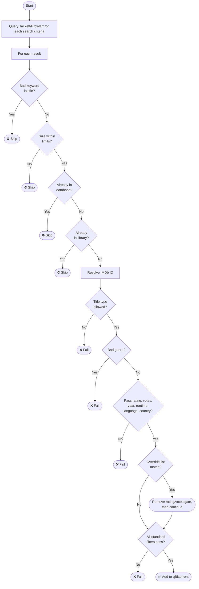

# movarr

Automated movie downloader based on IMDb criteria filtering.

## Features

- **Jackett and Prowlarr integration** — polls any Jackett-configured indexer (or all indexers at once) or a
  Prowlarr instance for movie torrents across configurable quality tiers (1080p, 2160p, 2160p remux, etc.).
- **Deep IMDb filtering** — every candidate is resolved to an IMDb ID and evaluated against rating, vote count,
  year, runtime, language, country, title type, and genre before anything is queued.
- **Override lists** — bypass the standard filters for specific directors, cast members, writers, movie titles, or
  characters (e.g. force-accept all James Bond films regardless of rating).
- **Genre threshold overrides** — relax rating and vote minimums on a per-genre basis (e.g. accept Animation
  titles at a lower rating floor than live-action).
- **Library deduplication** — resolves candidate titles to IMDb IDs and checks against all configured library
  paths before queuing, preventing duplicate downloads.
- **Database deduplication** — records every evaluated title in SQLite (titles whose release name has no
  parseable title/year are skipped without a record); previously passed, failed, or stalled
  titles are skipped on subsequent runs.
- **Configurable TTL expiry** — failed, stalled, and passed records are automatically pruned after configurable
  retention windows so titles can be re-evaluated over time.
- **Queue management** — monitors qBittorrent for torrents stuck in stalled or metadata-fetching states and
  removes them after configurable grace periods.
- **qBittorrent-aware queue management** — stalled torrent removal is paused when qBittorrent reports
  it is disconnected from the internet, preventing false positives from transient outages.
- **Post-processing** — detects completed downloads in qBittorrent, copies qualifying files to your media
  library, and removes source files if configured.
- **Genre/certification routing** — routes completed movies to different library paths per viewer profile based
  on genre and age-rating rules.
- **Notifications** — sends alerts via any [apprise](https://github.com/caronc/apprise)-compatible service
  (ntfy, Discord, Telegram, email, and more).  Notifications use Markdown formatting;
  ``?format=markdown`` is automatically appended to ntfy URLs for proper Markdown
  rendering.
- **Three independent schedulers** — acquisition and queue management run on their own configurable intervals;
  post-processing runs on a crontab expression so it can be confined to out-of-hours windows.
- **Automatic scheduler mode** — runs in continuous scheduling mode when any scheduler task is enabled in the
  config; with every scheduler disabled it logs that nothing is scheduled and exits.
- **Automatic config migration** — upgrades the YAML config schema automatically on startup, backing up the
  previous version before applying changes.
- **Search circuit breaker** — when the index proxy (Jackett/Prowlarr) search endpoint errors, the acquisition
  scheduler skips subsequent searches for a configurable cooldown window instead of burning through
  long retry cycles.  The circuit reopens automatically so movarr resumes as soon as the proxy recovers —
  no manual restart required.

## Prerequisites

- [Python 3.12+](https://www.python.org/downloads/)
- [Astral uv](https://github.com/astral-sh/uv#installation) (optional)
- [Jackett](https://github.com/Jackett/Jackett) or [Prowlarr](https://github.com/Prowlarr/Prowlarr) — torrent indexer proxy
- [qBittorrent](https://www.qbittorrent.org/) with Web UI enabled

Jackett and Prowlarr are contacted over plain HTTP only, and the qBittorrent WebUI certificate is not
verified. Run them on a trusted network (or behind a local reverse proxy) — TLS termination in front of
these services is not supported by movarr itself.

## Quick start

### Installation using uv (recommended)

```bash
git clone https://github.com/binhex/movarr
cd movarr
uv venv --quiet
uv sync
```

### Installation using pip

```bash
git clone https://github.com/binhex/movarr
cd movarr
python -m venv .venv
source .venv/bin/activate
pip install .
```

### Usage

```bash
movarr --help
```

## Options

All options are optional overrides. When an option is omitted, the value from `movarr.yml` is used.

### General

| Option | Description | Default |
| ------ | ----------- | ------- |
| `--config-path <dir>` | Directory containing `movarr.yml`. | `configs` |
| `--log-path <dir>` | Override the log directory from config. The file `movarr.log` is created inside. | *(from config)* |
| `--log-level <level>` | Override the console log level. Choices: `TRACE`, `DEBUG`, `INFO`, `SUCCESS`, `WARNING`, `ERROR`, `CRITICAL`. Useful for temporary debugging without editing the config file. | *(from config)* |
| `--db-path <dir>` | Override the database directory from config. The file `movarr.db` is created inside. | *(from config)* |
| `--pid-path <dir>` | Override the PID-file directory from config. The file `movarr.pid` is created inside. | *(from config)* |
| `--library-path <path[,path...]>` | Comma-separated list of library root paths, overrides `general.library_path_list` in config. Example: `/media/movies,/media/4k`. | *(from config)* |
| `--once` | Run each enabled scheduler task once, then exit (foreground mode). Post-processing runs regardless of its cron window. | `false` |
| `--test` | Validate configuration and exit without running any tasks. | `false` |
| `--version` | Print the version and exit. | — |

### qBittorrent

| Option | Description | Default |
| ------ | ----------- | ------- |
| `--qbt-host <host>` | Override qBittorrent WebUI host from config. | *(from config)* |
| `--qbt-port <port>` | Override qBittorrent WebUI port from config. | *(from config)* |
| `--qbt-username <user>` | Override qBittorrent username from config. | *(from config)* |
| `--qbt-password <pass>` | Override qBittorrent password from config. | *(from config)* |

### Index Proxy

| Option | Description | Default |
| ------ | ----------- | ------- |
| `--index-proxy <proxy>` | Override index proxy selection. Choices: `jackett`, `prowlarr`. | *(from config)* |
| `--jackett-host <host>` | Override Jackett host from config. | *(from config)* |
| `--jackett-port <port>` | Override Jackett port from config. | *(from config)* |
| `--jackett-api-key <key>` | Override Jackett API key from config. | *(from config)* |
| `--prowlarr-host <host>` | Override Prowlarr host from config. | *(from config)* |
| `--prowlarr-port <port>` | Override Prowlarr port from config. | *(from config)* |
| `--prowlarr-api-key <key>` | Override Prowlarr API key from config. | *(from config)* |

> **Unraid users:** movarr itself has no environment-variable support — the container entrypoint maps
> variables onto these CLI flags. Run movarr outside that image and you must pass the flags (or edit
> `configs/movarr.yml`) yourself.

## Configuration

All behaviour is controlled by a YAML file inside the config directory (`configs/movarr.yml` by default). A default config is created
automatically on first run. The file is divided into the sections below.

### `general`

| Key | Description | Default |
| --- | ----------- | ------- |
| `config_version` | Schema version — managed automatically; do not edit. | *(current)* |
| `log_level_console` | Console logging level (`trace`, `debug`, `info`, `success`, `warning`, `error`, `critical`). Overridden by `--log-level`. | `info` |
| `log_level_file` | File logging level (`trace`, `debug`, `info`, `success`, `warning`, `error`, `critical`). | `info` |
| `log_path` | Directory for the log file (`movarr.log` is created inside). Empty string disables file logging. Overridden by `--log-path`. | `"logs"` |
| `library_path_list` | Root paths to scan when checking whether a movie already exists in the library. Overridden by `--library-path`. | `[]` |
| `db_path` | Directory for the SQLite history database (`movarr.db` is created inside). Overridden by `--db-path`. | `"db"` |
| `pid_path` | Directory for the PID file (`movarr.pid` is created inside). Empty string disables PID file creation. Overridden by `--pid-path`. | `"pids"` |

### `schedule`

`acquisition` and `queue_management` share one schedule shape:

| Key | Description | Default |
| --- | ----------- | ------- |
| `enabled` | Enable or disable this task. | `true` |
| `schedule_time_mins` | Interval in minutes between runs. | `30` (acquisition), `5` (queue_management) |
| `run_on_start` | Run this task immediately when movarr starts, before the first interval elapses. | `true` |

`post_processing` is scheduled by crontab instead:

| Key | Description | Default |
| --- | ----------- | ------- |
| `enabled` | Enable or disable this task. | `true` |
| `run_on_start` | Run this task immediately when movarr starts, even outside the cron windows. Set to `false` for strict out-of-hours operation. | `true` |
| `cron` | A 5-field crontab expression, or a list of them whose windows are unioned. | `"*/5 * * * *"` |

`schedule.timezone` sets the IANA timezone the expressions are evaluated in (default: the container's
timezone, which is often UTC). The default also needs a resolvable local zone, so a container with no timezone
database must install `tzdata` — otherwise startup is rejected, both for the default and for a valid name such as
`Australia/Sydney`. Example — copy only overnight on weekdays, and only
before 06:00 at weekends:

```yaml
schedule:
  timezone: "Australia/Sydney"
  post_processing:
    enabled: true
    cron:
      - "* 0-7,23 * * 1-5"   # Mon-Fri 00:00-07:59 and 23:00-23:59
      - "* 0-5    * * 0,6"   # Sat/Sun 00:00-05:59
```

Tasks: `acquisition`, `queue_management`, `post_processing`.

### `filters`

Controls which torrents pass the IMDb quality gate.

| Key | Description | Default |
| --- | ----------- | ------- |
| `minimum_year` | Reject movies released before this year. | `1970` |
| `minimum_runtime_mins` | Reject movies shorter than this many minutes. | `60` |
| `minimum_rating` | Minimum IMDb rating (0–10). A value above `10` is treated as "no rating threshold". | `7.0` |
| `minimum_votes` | Minimum IMDb vote count. | `5000` |
| `override_genre` | Map of genre → `{minimum_rating, minimum_votes}` to relax thresholds for specific genres. | `{}` |
| `allow_imdb_title_type_list` | Allowed IMDb title types. | `[movie, video, tvmovie]` |
| `allow_country_list` | Allowed production country codes (ISO 3166-1 alpha-2). Empty = allow all. | `[]` |
| `allow_language_list` | Allowed spoken language codes (ISO 639-1). Empty = allow all. | `[]` |
| `reject_index_title_list` | Reject an index title when one of these keywords appears as a delimited token *after* the release year (case-insensitive). A title with no year is searched in full. Keywords before the year (e.g. a disabled `[CAM]` tag) are not matched. Empty by default — add your own (`CAM`, `TS`, ...) to enable. | `[]` |
| `reject_genre_list` | Reject any movie whose IMDb genres include one of these values. | `[]` |
| `reject_genre_exclusive_list` | Reject a movie only when ALL of its IMDb genres are in this list (e.g. add `Horror` to reject pure horror, keep horror/sci-fi hybrids). | `[]` |
| `reject_movie_title_list` | Reject movies whose resolved title exactly matches any entry. | `[]` |
| `reject_index_group_list` | Reject torrents from these release groups (case-insensitive). | `[]` |
| `override_cast_list` | Force-accept any movie featuring one of these cast members, bypassing the rating and vote-count minimums. Other filters (title type, genre, year, runtime, language, country, bitrate) and the library check still apply. | `[]` |
| `override_writer_list` | Force-accept any movie written by one of these writers. Same bypass scope as `override_cast_list`. | `[]` |
| `override_director_list` | Force-accept any movie directed by one of these directors. Same bypass scope as `override_cast_list`. | `[]` |
| `override_movie_title_list` | Force-accept a movie whose normalised title (or title + year) exactly equals one of these entries. Substring entries never match. Same bypass scope as `override_cast_list`. | `[]` |
| `override_character_list` | Force-accept any movie featuring one of these characters. Same bypass scope as `override_cast_list`. | `[]` |
| `preferred_index_group_list` | Preferred release group names. Gives a scoring bonus in the library and supersession comparisons (it does not reorder indexer results). | `[]` |

### `torrent_client`

| Key | Description | Default |
| --- | ----------- | ------- |
| `selected` | Torrent client to use. Currently only `qbittorrent` is supported. | `qbittorrent` |
| `qbittorrent.host` | qBittorrent Web UI hostname or IP address. | `localhost` |
| `qbittorrent.port` | qBittorrent Web UI port. | `8080` |
| `qbittorrent.username` | Web UI username. | `admin` |
| `qbittorrent.verify_webui_certificate` | Verify the qBittorrent WebUI TLS certificate. Leave `false` for a self-signed LAN certificate; enable it when the WebUI is reachable beyond your trusted network. | `false` |
| `qbittorrent.password` | Web UI password. | `adminadmin` |
| `qbittorrent.add_paused` | Add torrents in paused state. | `false` |
| `qbittorrent.category` | Category tag applied to all movarr-managed torrents. | `movies-movarr` |

### `notification`

| Key | Description | Default |
| --- | ----------- | ------- |
| `apprise_urls` | List of [apprise](https://github.com/caronc/apprise) service URLs. Leave empty to disable. | `[]` |
| `index_proxy_alert_hours` | Send an alert if the index proxy returns no results or is unreachable for this many consecutive hours. Set to `0` to disable. | `0` |
| `torrent_client_alert_hours` | Send an alert if the torrent client has been unreachable for this many consecutive hours. Set to `0` to disable. | `0` |

Apprise supports ntfy, Discord, Telegram, email, Slack, and many other services. Example:
`ntfy://my-topic`, `discord://webhook-id/webhook-token`.

### `index_proxy`

| Key | Description | Default |
| --- | ----------- | ------- |
| `selected` | Index proxy to use: `jackett` or `prowlarr`. | `jackett` |
| `jackett.host` | Jackett hostname or IP address. | `localhost` |
| `jackett.port` | Jackett port. | `9117` |
| `jackett.api_key` | Jackett API key (found in the Jackett dashboard). | `""` |
| `jackett.read_timeout` | HTTP read timeout in seconds. | `60.0` |
| `jackett.limit` | Maximum number of results to request per page. Must be greater than `0`. | `500` |
| `jackett.offset` | Maximum pagination offset. Pages are fetched from offset `0` upwards while the offset is less than or equal to this value, so `0` fetches a single page and `500` fetches pages `0` and `500`. | `0` |
| `jackett.ignore_list` | Jackett indexer names to skip when querying with `jackett_indexer: all`. Case-insensitive. | `[]` |
| `prowlarr.host` | Prowlarr hostname or IP address. | `localhost` |
| `prowlarr.port` | Prowlarr port. | `9696` |
| `prowlarr.api_key` | Prowlarr API key (found in *Settings → General*). | `""` |
| `prowlarr.read_timeout` | HTTP read timeout in seconds. | `60.0` |
| `prowlarr.limit` | Maximum number of results to request per query. | `500` |
| `prowlarr.ignore_list` | Prowlarr indexer names to skip when querying with `prowlarr_indexer: all`. Case-insensitive. | `[]` |
| `circuit_open_minutes` | Minutes to skip search after a proxy search error (circuit breaker). Set to `0` to disable. | `30` |

### `credentials`

| Key | Description | Default |
| --- | ----------- | ------- |
| `tmdb.api_key` | [TMDb](https://www.themoviedb.org/settings/api) API key (IMDb ID resolution fallback). | `""` |
| `omdb.api_key` | [OMDb](https://www.omdbapi.com/apikey.aspx) API key (IMDb ID resolution fallback). | `""` |

### `index_site`

Controls what is searched and which indexers are used.

| Key | Description | Default |
| --- | ----------- | ------- |
| `jackett_indexer` | Jackett indexer to query. Use `all` to query every configured indexer simultaneously. | `all` |
| `prowlarr_indexer` | Prowlarr indexer ID to query. Use `all` to search every configured indexer. | `all` |
| `search` | List of search criteria blocks (see below). | *(1080p only)* |
| `override_search` | Per-indexer overrides for the search **category**, keyed by indexer name. Only the `category` key is read; any other key is ignored. | `{}` |

Each entry in `search`:

| Key | Description | Default |
| --- | ----------- | ------- |
| `criteria` | Search string passed to the index proxy (e.g. `1080p`, `2160p remux`). | — |
| `category` | Torrent category codes, comma-separated (Torznab format). | `2000,5000` |
| `minimum_size_mb` | Minimum torrent size in MB. | `3000` (the shipped 1080p tier; ~`7000` suits a 2160p tier you add) |
| `maximum_size_mb` | Maximum torrent size in MB. | `20000` (the shipped 1080p tier; ~`170000` suits a 2160p tier you add) |
| `minimum_bitrate_mb` | Minimum video bitrate in MB/min. Set `0` to disable. | `50` (the shipped 1080p tier; ~`115` suits a 2160p tier you add) |

### `queue_management`

| Key | Description | Default |
| --- | ----------- | ------- |
| `queue_management_enabled` | Master switch for the queue management pipeline. | `true` |
| `stalled_monitor_enabled` | Remove torrents that have stalled (no peers, no download progress). | `true` |
| `metadata_monitor_enabled` | Remove torrents stuck in metadata-fetching state. | `true` |
| `stalled_delete_torrent_data` | Also delete downloaded data when removing a stalled torrent. | `true` |
| `metadata_delete_torrent_data` | Also delete downloaded data when removing a metadata-stuck torrent. | `true` |
| `stalled_delete_torrent_max_mins` | Minutes a torrent must be continuously stalled before it is removed. Must be at least `1`. | `120` |
| `metadata_delete_torrent_max_mins` | Minutes a torrent must be stuck in metadata-fetching state before removal. Must be at least `1`. | `30` |
| `supersede_enabled` | When a higher-quality torrent for the same IMDb ID is queued, cancel the inferior download and delete its partial data. Requires the IMDb ID in the qBittorrent tag (automatic with v2.22.0+). Never applies to completed torrents, a different edition/cut, or when `add_paused` is enabled (the replacement would not start). | `false` |

### `post_process`

| Key | Description | Default |
| --- | ----------- | ------- |
| `post_process_enabled` | Master switch for the post-processing pipeline. | `true` |
| `copy_completed` | Copy completed files to the media library. | `true` |
| `remove_completed` | Remove the torrent from qBittorrent after a successful copy, deleting its data. With `copy_completed: false` the torrent is still removed but the data is always kept (the download itself is the library copy). | `true` |
| `exclude_file_min_kb` | Files smaller than this size (kilobytes) are not copied (skips small extras and samples). | `1500000` |
| `exclude_file_regex_list` | Regex patterns matched against file names — matching files are skipped. | `[]` |
| `exclude_folder_regex_list` | Regex patterns matched against folder names — matching folders and their contents are skipped. | `[]` |
| `copy_library_rules` | List of routing rules (see below). The rule with the highest genre-overlap score wins. | `[]` |
| `default_copy_library.hd_path` | Fallback destination for HD movies when no rule matches or two rules tie. | `""` |
| `default_copy_library.uhd_path` | Fallback destination for UHD/4K movies when no rule matches or two rules tie. Empty falls back to `hd_path`. | `""` |
| `delete_lower_quality` | Auto-delete lower-quality library files when a better version is copied. Extras/bonus files and releases of a different edition or cut are preserved. Requires `general.library_path_list` — without it the quality check cannot run, so deletion is skipped. Permanent deletion — use with care. | `false` |

### `post_process.poster_art`

| Key | Description | Default |
| --- | ----------- | ------- |
| `filename` | Filename for the poster image saved into the movie folder (always stored as `.jpg`). Empty disables poster saving. | `""` (disabled) |
| `download_width` | Requested image width in pixels, applied to Amazon poster URLs. `0` downloads the original size. | `0` |

Each entry in `copy_library_rules`:

| Key | Description |
| --- | ----------- |
| `name` | Human-readable label for this rule (e.g. a viewer's name). |
| `genres` | List of IMDb genres that match this rule. |
| `max_certification` | Optional age-rating ceiling (e.g. `12A`). Movies rated above this are skipped for this rule. Only applied when the certificate came from IMDbPie (BBFC); MPAA ratings from OMDb fall back to `default_copy_library`. |
| `hd_path` | Destination directory for 1080p / HD movies. |
| `uhd_path` | Destination directory for 2160p / UHD movies. |

### `post_process.hooks`

| Key | Description | Default |
| --- | ----------- | ------- |
| `pre_copy` | Shell command to run before each copy. Failure aborts the copy. `{dir}` is substituted with the absolute destination directory. `{leaf}` is substituted with the last path component (e.g. movie folder name). | `""` (disabled) |
| `post_copy` | Shell command to run after each successful copy. `{dir}` is substituted with the absolute destination directory. `{leaf}` substituted likewise. | `""` (disabled) |
| `pre_delete` | Shell command to run before the deletion pass. Failure aborts deletion. `{dir}` and `{leaf}` substituted. | `""` (disabled) |
| `post_delete` | Shell command to run after the deletion pass. Failure is non-fatal. `{dir}` and `{leaf}` substituted. | `""` (disabled) |
| `hook_timeout_mins` | Timeout in minutes for each hook. `0` disables the timeout, so a hung hook blocks the post-processing thread indefinitely. | `5.0` |

`post_copy` is skipped when only non-video files (subtitles, artwork) were copied — the torrent is then marked
completed without being treated as a successful feature copy.

`pre_delete` and `post_delete` only fire from the superseded-file deletion pass, so they need
`delete_lower_quality: true` **and** a non-empty `general.library_path_list`. A hook configured without
those two settings never runs.

Hooks must not rename or move the target files. Use only in-place operations (e.g. `chattr -i`, `trimarr`).

### `database`

| Key | Description | Default |
| --- | ----------- | ------- |
| `stalled_expiry_days` | Delete stalled history records older than this many days, allowing the title to be retried. | `7` |
| `failed_expiry_days` | Delete failed history records older than this many days, allowing the title to be re-evaluated. | `7` |
| `passed_expiry_days` | Delete passed history records older than this many days. Allows re-queuing if qBittorrent was reset externally. Set `0` to disable. | `30` |

## How it works

movarr runs three independent pipelines on configurable schedules.

### Acquisition pipeline



### Queue management pipeline

Runs on its own interval and inspects all movarr-managed torrents in qBittorrent:

- **Stalled torrents** — torrents with no peers and no download progress for longer than
  `stalled_delete_torrent_max_mins` are removed. The history record is updated to `Stalled` and
  `stalled_expiry_days` controls when the title can be retried.
- **Metadata-stuck torrents** — torrents that have been fetching metadata for longer than
  `metadata_delete_torrent_max_mins` are removed.
- **Connectivity guard** — if qBittorrent reports it is disconnected from the internet, queue management
  is paused until connectivity returns (so stalled torrents are not incorrectly deleted during an outage).

### Post-processing pipeline

Runs on its own interval and inspects all movarr-managed torrents in qBittorrent:

1. Detects torrents with a completed status.
2. Scans the download directory, skipping files and folders that match the exclude rules.
3. Resolves the destination: the `copy_library_rules` entry with the highest
   genre-overlap score wins; a tie or no match falls back to `default_copy_library`.
4. Copies qualifying files to the destination; removes source files if `remove_completed` is enabled.
5. Deletes superseded library files when `delete_lower_quality` is enabled.
6. Marks the history record as `Completed`.

## Scheduler

movarr runs three schedulers concurrently on one APScheduler instance. Acquisition and queue management use a
**fixed interval**; the next fire time is computed from the previous *scheduled* time, so drift does not
accumulate. Post-processing uses a **crontab expression**, evaluated in `schedule.timezone`.

All three jobs run with `max_instances=1`, so a run in flight is never overlapped, and `coalesce=True`, so a run
that overruns its slot is followed by one coalesced run rather than a burst of catch-ups.

| Task | Schedule | Config key |
| ---- | -------- | ---------- |
| Acquisition | every 30 min | `schedule.acquisition` |
| Queue management | every 5 min | `schedule.queue_management` |
| Post-processing | `*/5 * * * *` | `schedule.post_processing` |

Post-processing is the task that saturates disk IO, so it is the one worth pinning to quiet hours. Two details
matter when writing its expression:

- **Hours are inclusive, minutes are not.** Hour `0-5` runs from 00:00 to 05:59; the window ends when the hour
  field stops matching. The minute field sets the cadence inside the window (`*/5` = every five minutes).
- **Weekday numbers follow crontab, not APScheduler.** `0` and `7` are Sunday, `1` is Monday, `5` is Friday,
  and a range such as `0-7` means every day. Day names (`mon`..`sun`) are accepted in any case (`MON-FRI`
  works) and are the safest choice. An expression that restricts *both* day-of-month and day-of-week is
  rejected, because crontab would OR the two fields while the scheduler ANDs them.

Upgrading from config version 2.24.0 converts the old `schedule_time_mins` into a `cron` cadence. Up to one week
the cadence never runs more often than the interval did, measured on the wall clock so a daylight-saving shift can
compress one gap by an hour (90 minutes becomes every two hours); longer intervals use
daily, weekly or monthly cadences up to 28 days, and anything longer uses a yearly cadence (so a 30-day interval
becomes yearly rather than risking a more frequent February run). Calendar cadences can drift by a few days because
months and years vary in length. A warning is logged whenever the cadence has to round up, whenever the old interval exceeded a year, and
whenever the old value is not a whole number of minutes (that falls back to the yearly cadence). A non-positive
interval is rejected, and a `cron` value already present in the file is kept as written unless this version cannot
build a trigger from it, in which case it is replaced by the converted interval and a warning is logged.
Upgrading also deletes the obsolete `schedule_time_units` key from `acquisition`, `queue_management` and
`post_processing`: it came from siphonator and was never read by movarr, so the only thing it produced was an
unknown-key warning.

A restart with `run_on_start: true` runs post-processing immediately, even outside the window. Set
`run_on_start: false` if restarts must also respect it. `--once` always runs post-processing and logs that the
window was bypassed.

Any task can be disabled independently by setting `enabled: false` in its schedule block.

## Development

```bash
git clone https://github.com/binhex/movarr
cd movarr
uv venv --quiet
uv sync
```

If you wish to perform linting on all files before committing (PR will not be
accepted if it does not pass all linting) then run `pre-commit run --all-files`.

### Running tests

```bash
uv run pytest
```

## FAQ

**Q: movarr queued a movie I already have. Why?**

Library matching extracts the movie title and year from the torrent's index title and scans your
`library_path_list` for video files whose sanitised filename has the same normalised title and year
(an exact match). If the filename does not match but the containing folder does, the folder name is used
as a fallback, and that fallback accepts a truncated or extended title (a substring match). Ensure your
media files include the release year in their filename (e.g. `The Matrix 1999 1080p BluRay.mkv`) or
organise movies into folders whose names contain the full movie title and year (a folder-only layout such as
`The Matrix (1999)/movie.mkv` is matched, but because the file carries no resolution token movarr treats the
existing copy as better and will not upgrade it). For foreign-language
titles movarr also matches the film's original title and up to three IMDb alternate titles, so a library
file named with the English release title is still recognised when the index title is the
original-language one.

**Q: How do I prevent movarr from downloading non-English movies?**

Set `filters.allow_language_list` to `[en]`. A title passes when **any** of its IMDb spoken languages is in the
list, so a film tagged `[French, English]` is accepted.

**Q: Can I force-accept a specific director's entire filmography?**

Yes — add the director's name to `filters.override_director_list`. For matching titles the rating and
vote-count minimums are bypassed; every other filter (title type, genre, year, runtime, language, country,
bitrate) and the library check still apply. The same pattern applies to `override_cast_list`,
`override_writer_list`, `override_movie_title_list`, and `override_character_list`.

**Q: What happens if qBittorrent is not reachable?**

The acquisition pipeline skips the search entirely if qBittorrent is unreachable. The post-processing and queue
management pipelines also log a warning and skip their cycles when qBittorrent is unavailable.

**Q: How do I disable passed record expiry?**

Set `database.passed_expiry_days: 0`. This prevents movarr from ever re-queuing a title that was previously
sent to qBittorrent, even if qBittorrent is reset externally.

**Q: I am using no_ransom script to secure my media, is it possible to use the 'pre_delete' hook to unlock existing media before deletion?**

Yes - however there are three additional changes you will need to make to the movarr container for this to work with the no_ransom script:

- Grant chattr additional permissions inside the container
This is done by adding in the following to the extra parameters field for the container: `--cap-add LINUX_IMMUTABLE`.

- Pass through the 'diskX' shares to the container, this is required for no_ransom as chattr cannot traverse FUSE shares (/mnt/user/...)
This is done by creating an additional path and setting the container path and host path to `/mnt`.

- chattr MUST be run as root, so in order for no_ransom to operate you either need to switch to root account or use sudo.

___
If you appreciate my work, then please consider buying me a beer  :D

[](https://www.paypal.com/cgi-bin/webscr?cmd=_s-xclick&hosted_button_id=MM5E27UX6AUU4)
